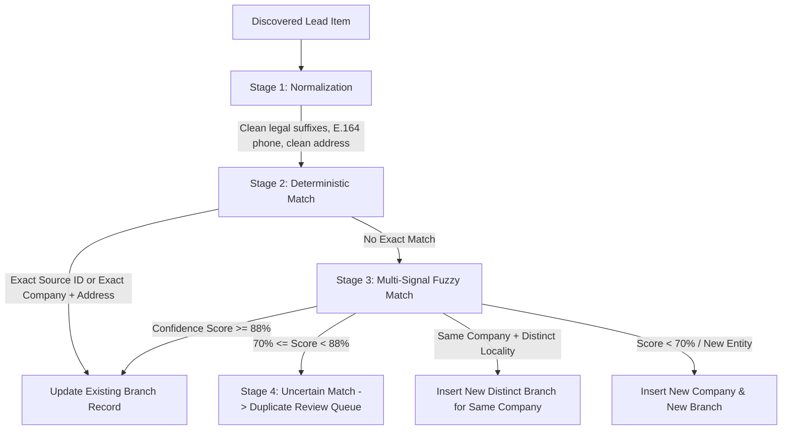

# India Leads Platform 🇮🇳

**Production-Grade India-Only B2B Business Lead Generation, Contact Enrichment & Data Intelligence Web Application**

Built specifically for high-integrity B2B lead generation across Indian cities, districts, localities, and PIN codes (e.g. *Mohali + Salon*, *Chandigarh + Restaurant*, *Delhi + Real Estate Agents*, *Ludhiana + Manufacturers*, *Bengaluru + IT Companies*).

---

## 1. Architectural Highlights

- **Strict India Geographic Scope**: Exclusive geographic reference validation for all 28 states and 8 union territories of India. Foreign locations are rejected at API ingress.
- **Branch-Level Deduplication Engine**: 4-stage matching algorithm that preserves separate branches of the same franchise (e.g. *ABC Salon — Phase 7, Mohali* vs *ABC Salon — Phase 3B2, Mohali*) while merging duplicate representations of the same branch (*ABC Beauty Salon — Phase 7, Mohali*).
- **Compliant Sourcing & Provenance Architecture**: Decouples temporary discovery previews (e.g. Google Places) from permanent CRM storage. Only independently verified or licensed records can be saved and exported.
- **Verified Indian Phone Normalization (+91 E.164)**: Implemented using Google's `phonenumbers` library (`libphonenumber`). Normalizes all equivalent formats (`9876543210`, `+91 98765 43210`, `091-9876543210`) to `+919876543210`. Distinguishes mobile numbers from landlines (with STD codes) and WhatsApp links.
- **Polite Contact Enrichment & SSRF Defense**: Asynchronously crawls authorized business websites, inspecting `mailto:` links, public contact numbers, and social profiles (Instagram, Facebook, LinkedIn, YouTube). Strictly blocks private subnets (`127.0.0.1`, `10.0.0.0/8`, `192.168.0.0/16`, `172.16.0.0/12`) and cloud metadata (`169.254.169.254`).
- **Spreadsheet Formula Injection Safeguard**: Sanitizes all export cells starting with `=, +, -, @, \t, \r` to prevent CSV/Excel formula injection attacks.
- **Dual Operating Modes**:
  - **MODE A: Deterministic Free Testing Mode (Default)**: Zero external paid credentials required. Real executable unit/integration tests and deterministic demo fixtures clearly labeled `[DEMO DATA]`.
  - **MODE B: Live Provider Mode**: Activated when official Google Places or Google Custom Search API keys are configured.

---

## 2. Technology Stack

### Frontend
- **Framework**: Next.js 14 (App Router)
- **Language**: TypeScript
- **Styling**: Tailwind CSS & Lucide Icons
- **Data Fetching & Caching**: TanStack Query (React Query v5) with reactive polling
- **Data Grid**: TanStack Table v8 with server-side pagination and row selection
- **Forms & Validation**: React Hook Form & Zod

### Backend
- **Framework**: Python 3.12 & FastAPI
- **Validation**: Pydantic v2 & Pydantic-Settings
- **ORM & Migrations**: SQLAlchemy 2.0 & Alembic
- **Database**: PostgreSQL 16 (with `pg_trgm` extension for fuzzy similarity) / SQLite for local test fallback
- **Background Processing**: Celery 5.4 & Redis 7 (supports eager execution for zero-dependency local runs)
- **Data Enrichment**: `httpx`, `beautifulsoup4`, `phonenumbers`, `email-validator`, `rapidfuzz`
- **Spreadsheet Generation**: `openpyxl` & Python `csv` with UTF-8 BOM encoding

---

## 3. Project Structure

```
india-leads-platform/
  frontend/
    src/
      app/
        (auth)/login/page.tsx             # Login & local credentials
        (dashboard)/
          dashboard/page.tsx             # Metrics, charts, recent jobs
          search/page.tsx                # Dynamic Indian search form
          leads/page.tsx                 # Paginated leads table & filters
          leads/[id]/page.tsx            # Full branch detail & enrichment
          jobs/page.tsx                  # Search jobs with live progress
          duplicates/page.tsx            # Side-by-side duplicate review
          imports/page.tsx               # Licensed CSV / XLSX importer
          exports/page.tsx               # Download CSV & Excel files
          settings/page.tsx              # Provider & compliance status
      components/
        leads/leads-table.tsx            # TanStack Table
        search/search-form.tsx           # Location autocomplete & filters
        jobs/job-progress-card.tsx       # Live status & item counters
        duplicates/duplicate-review-card.tsx
      hooks/                             # React Query hooks
      lib/api-client.ts                  # Type-safe API client
      types/index.ts                     # TypeScript schemas
  backend/
    app/
      core/config.py                     # Pydantic settings & env
      core/database.py                   # SQLAlchemy engine & session
      core/security.py                   # JWT & bcrypt password hashing
      api/v1/endpoints/                  # FastAPI REST endpoints
      models/                            # SQLAlchemy models (15 tables)
      schemas/                           # Pydantic schemas
      repositories/                      # Lead, job, duplicate, location queries
      services/
        discovery/                       # Google Places, Search, Licensed, Demo
        enrichment/                      # Crawler, phone, email, social extractors
        deduplication/                   # 4-stage matcher & resolver
        exports/                         # CSV and Excel export generators
      workers/                           # Celery app & background tasks
      utils/ssrf_guard.py                # SSRF prevention utility
    alembic/                             # Database migrations
    tests/                               # Automated pytest suite
  database/
    seed/demo_leads.json                 # Deterministic sample fixtures
    init.sql                             # PostgreSQL pg_trgm initialization
  data/
    locations/india_states_cities.json   # Indian geographic reference data
    sample/sample_licensed_leads.csv     # Sample CSV import file
  scripts/
    setup.ps1                            # Automated Windows PowerShell setup
    start-all.ps1                        # Quick launch backend + frontend
    seed_demo.py                         # Seeder script
  docker-compose.yml                     # Full Docker multi-container stack
  .env.example                           # Configuration template
```

---

## 4. Getting Started on Windows 10/11 (PowerShell)

### Quick Automated Launch (Recommended)

1. Open **Windows PowerShell** (or Terminal) and navigate to the project directory:
   ```powershell
   cd d:\india-leads-platform
   ```

2. Run the automated setup script:
   ```powershell
   .\scripts\setup.ps1
   ```
   *This automatically creates the `.venv`, installs Python requirements, seeds the database with Indian locations & demo leads, and installs frontend dependencies.*

3. Start both services simultaneously:
   ```powershell
   .\scripts\start-all.ps1
   ```
   - **Frontend UI**: [http://localhost:3000](http://localhost:3000)
   - **Backend API**: [http://localhost:8000](http://localhost:8000)
   - **Interactive Swagger Docs**: [http://localhost:8000/docs](http://localhost:8000/docs)

4. Sign in with the pre-filled local admin credentials:
   - **Email**: `admin@indialeads.internal`
   - **Password**: `Admin@123456`

---

### Running via Docker Compose

If you have Docker Desktop with WSL2 running:

```powershell
# Build and bring up PostgreSQL (with pg_trgm), Redis, FastAPI backend, Celery worker, and Next.js frontend
docker compose up --build -d

# View service logs
docker compose logs -f backend
```

---

## 5. Verification & Running Automated Tests

Run the comprehensive automated test suite:

```powershell
# Activate backend virtual environment
.\backend\.venv\Scripts\Activate.ps1

# Run all automated tests with pytest
cd backend
pytest -v
```

The automated test suite verifies:
- **India Location Scope**: Validates Indian cities (Mohali, Chandigarh, Delhi, Bengaluru, etc.) and PIN codes; rejects foreign cities.
- **Phone Normalization**: Confirms that `9876543210`, `+91 98765 43210`, and `091-9876543210` normalize to the identical E.164 format `+919876543210`.
- **Branch Separation vs Merging**: Confirms that different branches (*Phase 7* vs *Phase 3B2*) remain distinct leads, while name variations of the same branch are updated without duplicating.
- **Contact Extraction**: Validates `mailto:`, phone numbers, and WhatsApp links; rejects placeholder emails (`example@example.com`, `.png`).
- **SSRF Guard**: Validates that loopback (`127.0.0.1`), private RFC1918 subnets, and AWS metadata IP (`169.254.169.254`) are blocked.
- **Export Sanitization**: Confirms spreadsheet formula injection strings (`=, +, -, @`) are prepended with an apostrophe.

---

## 6. How the 4-Stage Deduplication Engine Works



1. **Phase 7 vs Phase 3B2 in Mohali**: When *Glamour Studio* in *Phase 3B2* is discovered after *Glamour Studio* in *Phase 7*, the engine recognizes the company identity, detects distinct locality tokens, and inserts a **new branch** under the existing company.
2. **Name Variations**: When *Glamour Studio Salon & Spa - Phase 7* arrives after *Glamour Studio Salon - Phase 7*, the normalizer collapses both to the same normalized branch name and address in Phase 7, performing an atomic update instead of duplicating.

---

## 7. Data Provenance & Compliance Summary

| Source Code | Provider Name | Storage Status | Export Status | Enrichment Allowed | Notes |
| :--- | :--- | :--- | :--- | :--- | :--- |
| `demo_fixture` | Deterministic Offline Fixture | Permitted | Permitted | Permitted | Labeled `[DEMO DATA]` for zero-credential testing. |
| `licensed_csv` | Commercial Dataset Import | Permitted | Permitted | Permitted | User-imported records with verified commercial usage terms. |
| `google_places`| Google Places API (New/v1) | Temporary Preview | Restricted | No | Official API text query. Discovery preview only. |
| `google_search`| Google Custom Search API | Permitted (URLs) | Restricted | Permitted | Authorized Custom Search API. Used to locate business domains. |

